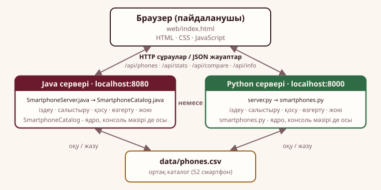

# SmartPick — Find Your Perfect Phone

№24 жоба «Смартфондар каталогы» — Java + Python.

Жобаның логикасы екі «ядрода» жазылған: **`java/SmartphoneCatalog.java`** және **`python/smartphones.py`**.
Бұл ядроларды консоль мәзірі де, веб-сервер де қолданады, сондықтан консольдегі және сайттағы нәтиже бірдей.
Деректер ортақ `data/phones.csv` файлында сақталады (52 смартфон).

## Сайт

Сайтта жарық / қараңғы тема және үш тіл бар: қазақша, орысша, ағылшынша (таңдау браузерде сақталады).

## Жоба схемасы



```
SmartphoneProject/
├── web/
│   └── index.html              ← сайт (HTML, CSS, JavaScript)
├── java/
│   ├── SmartphoneCatalog.java  ← Java ядросы + консоль мәзірі
│   └── SmartphoneServer.java   ← Java веб-сервері (порт 8080), ядроны шақырады
├── python/
│   ├── smartphones.py          ← Python ядросы + консоль мәзірі
│   └── server.py               ← Python веб-сервері (порт 8000), ядроны шақырады
├── data/
│   └── phones.csv              ← ортақ каталог
├── docs/
│   └── schema.svg              ← схема суреті
├── run_java.bat                ← Java сайты
├── run_python.bat              ← Python сайты
├── run_console_java.bat        ← Java консоль мәзірі
└── run_console_python.bat      ← Python консоль мәзірі
```

## Іске қосу

| Не | Файл | Талап |
|---|---|---|
| Java сайты | `run_java.bat` → http://localhost:8080 | JDK 17+ |
| Python сайты | `run_python.bat` → http://localhost:8000 | Python 3.10+ |
| Java консоль | `run_console_java.bat` | JDK 17+ |
| Python консоль | `run_console_python.bat` | Python 3.10+ |

Қосымша кітапхана орнатудың қажеті жоқ.

## Функциялар

Смартфон қосу, өзгерту, жою · бренд / баға / жады / бренд + жады бойынша іздеу · камераны салыстыру ·
екі смартфонды салыстыру · ең арзан / ең қымбат · статистика (орташа баға, бренд бойынша саны) · каталогты шығару.

Java-да Method Overloading: `search` (3 нұсқа), `addPhone` (3), `showCatalog` (2), `compareCamera` (2),
`updatePhone` (2), `deletePhone` (2), `readInt` (2), `readText` (2).
Python-да оның орнына әдепкі параметрлер және параметр түрін тексеру қолданылады.

## API (екі серверде бірдей)

| Сұрау | Не істейді |
|---|---|
| `GET /api/info` | сервер түрі мен нұсқасы |
| `GET /api/phones?brand=&min=&max=&memory=&ram=&battery=&camera=&q=&sort=` | іздеу, сүзгі, реттеу |
| `GET /api/stats` | ең арзан, ең қымбат, орташа баға, бренд бойынша саны |
| `GET /api/compare?a=1&b=2` | екі смартфонды және камераларын салыстыру |
| `POST /api/phones` | жаңа смартфон қосу |
| `POST /api/phones/update` | смартфонды өзгерту (`id` + өрістер) |
| `POST /api/phones/delete` | смартфонды жою (`id`) |
